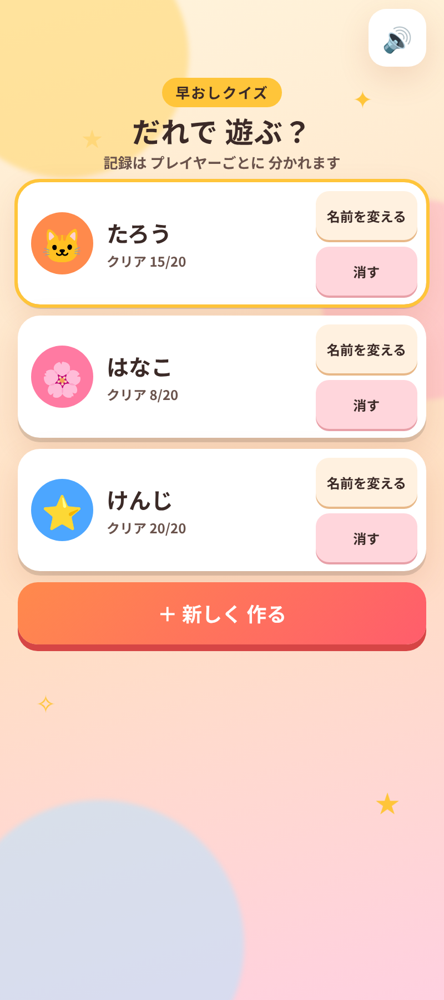
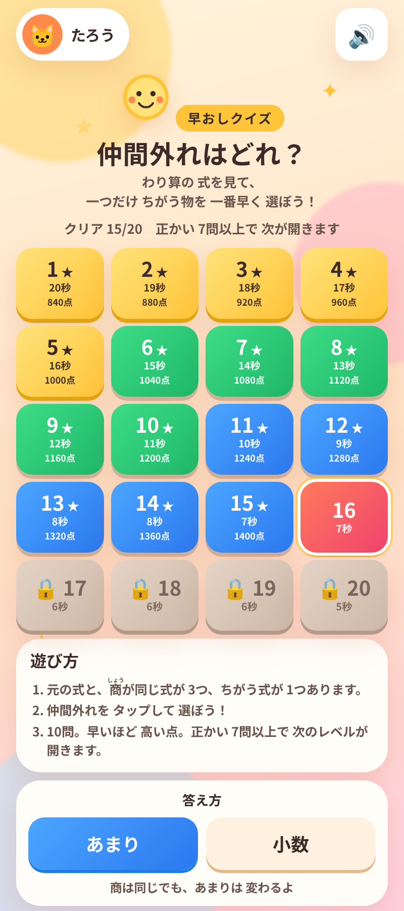
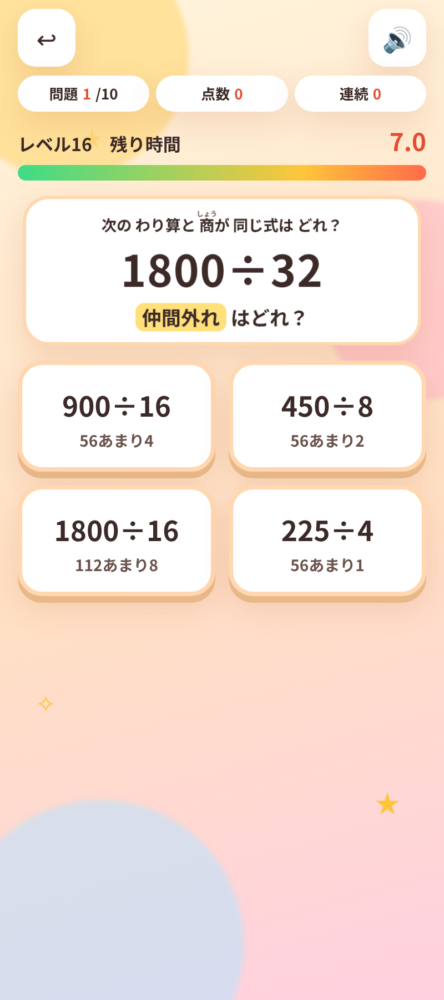

# 早押し「なかまはずれはどれ？」わり算クイズ

小学4年生向けのわり算早押しクイズです。元の式と商（しょう）が同じ式が3つ、違う式が1つ出ます。仲間はずれをいちばん早く選びます。

遊べる場所: https://hissy.github.io/hayaoshi-warizan/

## 遊び方

1. プレイヤーを選ぶか、新しく作ります。記録はプレイヤーごとに残ります。
2. レベルを選びます。レベルは1から20まであり、上がるほど数が大きく、1問の制限時間は短くなります。
3. 出た式を見て、4つの式のうち仲間はずれをタップします。1回は10問です。
4. 早いほど点数は高くなります。7問以上正解すると、次のレベルが開きます。
5. レベル15からは、あまりのほかに小数でも答えられます。

ブラウザで `index.html` を開いても遊べます。





## テスト

Node.js で、リポジトリのルートから次を実行します。

```bash
node test-generator.js
node test-players.js
node check-kanji.js
```

- `test-generator.js` は、20レベルの問題の作り方を調べます。
- `test-players.js` は、プレイヤーごとの記録の保存を調べます。
- `check-kanji.js` は、画面に出る漢字が小学1〜4年の範囲かを調べます。
